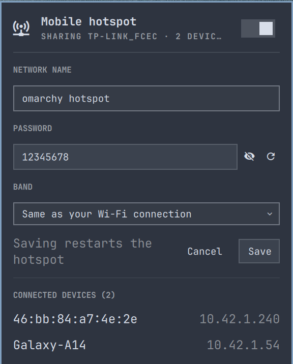

# Omnispot

[](https://github.com/nwgkgit/omnispot/actions/workflows/ci.yml)
[](LICENSE)

A native mobile hotspot plugin for the [Omarchy](https://omarchy.org) desktop bar. Flip a toggle and your laptop shares its internet connection over Wi-Fi. It supports sharing existing Wi-Fi connections simultaneously over a virtual interface.

<p align="center">
  
</p>

## Installation

Install using the Omarchy plugin manager:

```bash
omarchy plugin add https://github.com/nwgkgit/omnispot.git --enable
```

Optionally adjust widget position on the bar:

```bash
omarchy bar move hotspot.omarchy --section left
```

Click the hotspot icon in the bar, click **Set up**, and authenticate with your password. This one-time step:
- Installs the privileged helper (`omarchy-hotspot-helper`)
- Configures NetworkManager to unmanage the virtual `ap0` interface
- Adds a polkit rule allowing your active user session to control the hotspot without prompting for passwords

Once setup is complete, click the toggle to activate your hotspot.

### Requirements

| Package | Purpose | Included with Omarchy |
|---------|---------|-----------------------|
| `python3` (3.11+) | Backend service logic | Yes |
| `hostapd` | Access point daemon | No: install with `sudo pacman -S hostapd` |
| `iw` | Wireless interface configuration | Yes |
| `dnsmasq` | DHCP/DNS for client devices | Yes |
| `iptables` | NAT and packet forwarding | Yes |
| `nmcli` | NetworkManager state queries | Yes |
| `polkit` | Passwordless helper authorization | Yes |

`hostapd` is the only external dependency required. The setup UI will indicate if it needs to be installed.

### Updating

```bash
omarchy plugin update hotspot.omarchy
omarchy restart shell
```

### Uninstallation

Remove system-level files installed during setup:

```bash
python3 ~/.config/omarchy/plugins/hotspot.omarchy/lib/hotspot.py uninstall
```

Then remove the plugin:

```bash
omarchy plugin remove hotspot.omarchy
```

User configuration files can optionally be deleted:

```bash
rm -rf ~/.config/omarchy/hotspot
```

## Features

- **One-click Hotspot**: Toggle directly from the panel switch or right-click the bar icon.
- **Concurrent Wi-Fi Sharing**: Connect to an upstream Wi-Fi network and broadcast an access point at the same time using a secondary virtual AP interface.
- **Live Device Monitoring**: Displays connected clients, hostnames, and assigned DHCP addresses in real time.
- **Band Handling**: When sharing a wired/Ethernet connection, choose between 2.4 GHz, 5 GHz, or any available band. When sharing an active Wi-Fi connection, Omnispot automatically matches your Wi-Fi card's active channel and band.
- **WPA2 Security**: Built-in credential generator with visibility toggle.
- **CLI and IPC Integration**: Scriptable via `omarchy-shell` (e.g. `omarchy-shell hotspot.omarchy start`).

## How It Works

Most contemporary Wi-Fi chipsets support simultaneous client and access point operation via multiple virtual interfaces (`__ap` mode). Omnispot leverages this capability directly:

- **`lib/hotspot.py`**: Runs in your user session. Discovers network devices, resolves subnet conflicts, handles settings persistence in `~/.config/omarchy/hotspot/settings.json`, and communicates with QML via structured JSON.
- **`omarchy-hotspot-helper`**: Runs as root via `pkexec`. Creates the virtual `ap0` interface, runs `hostapd` and `dnsmasq`, and manages `iptables` NAT forwarding.
- **Subnet Isolation**: Subnet assignment defaults to `10.42.0.0/24`. If another interface conflicts, Omnispot automatically selects the next available candidate from the routing table.

Detailed architecture and component notes are available in [docs/HOW_IT_WORKS.md](docs/HOW_IT_WORKS.md).

## Troubleshooting

- **"hostapd is required but not installed"**:
  Install `hostapd` using pacman:
  ```bash
  sudo pacman -S hostapd
  ```

- **Panel reports an error starting with `hostapd:`**:
  Your wireless adapter might not support access point mode on the current channel. Certain adapters restrict 5 GHz access point creation. If sharing Wi-Fi, connect your laptop to a 2.4 GHz network so the hotspot follows it; if sharing Ethernet, select 2.4 GHz in the band dropdown.

- **Devices connect but cannot reach the internet**:
  Verify internet connectivity on the host laptop. Inspect packet forwarding rules:
  ```bash
  sudo iptables -S FORWARD | grep ap0
  ```

- **Inspect backend diagnostics directly**:
  ```bash
  python3 lib/hotspot.py status
  python3 lib/hotspot.py start
  ```

## Development

Omnispot uses `uv` for Python dependency and environment management:

```bash
# Run backend test suite
uv run pytest test/ -v

# Run code style and lint checks
uv run ruff check lib/ test/
```

All test cases mock network interfaces and root commands, enabling full execution in local environments without root privileges or wireless hardware.

## Project Structure

```
├── BarWidget.qml              Omarchy top-bar widget
├── HotspotPanel.qml           Dropdown control and settings panel
├── HotspotState.qml           QML to Python IPC bridge
├── omarchy-hotspot-helper     Root helper script (hostapd, dnsmasq, iptables)
├── manifest.json              Omarchy plugin manifest
├── pyproject.toml             uv and Python packaging configuration
├── lib/
│   └── hotspot.py             Backend service logic
├── test/
│   ├── conftest.py            Test fixtures and isolated mocks
│   └── test_hotspot.py        Unit and integration test cases
└── docs/
    ├── HOW_IT_WORKS.md        System design and component interactions
    └── screenshots/
        └── panel.png          UI screenshot
```

## License

MIT. See [LICENSE](LICENSE) for details.
